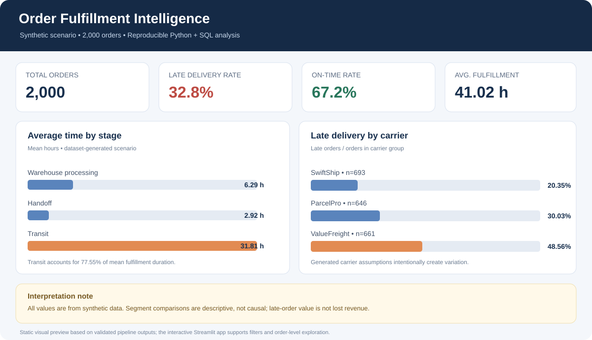
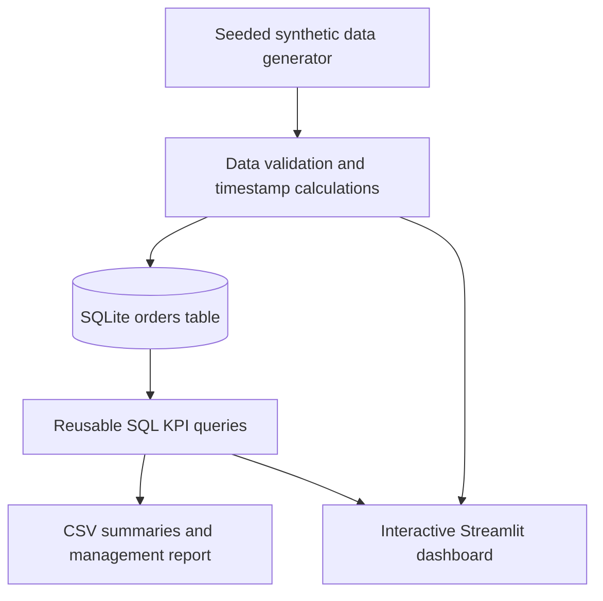

# Order Fulfillment SLA & Delay Analysis

**An end-to-end Business Analyst project** using Python, SQL, SQLite and an interactive Streamlit dashboard to investigate delivery delays in a reproducible synthetic e-commerce dataset.

> **Data notice:** All orders and SLA assumptions are synthetic and created for portfolio demonstration. Segment results do not represent a real organisation, and observed differences are not proof of causation. No savings or performance improvement is claimed.

## Business question

An e-commerce operations team is concerned about late deliveries. How much of the fulfillment journey is spent in warehouse processing, carrier handoff and transit? Which warehouse, carrier or region should be investigated first, and what evidence would be needed before taking action?

## What the project includes

- **Reproducible data generation:** 2,000 synthetic orders with order, packing, shipment, delivery and promised-delivery timestamps.
- **Data validation:** required-field checks, unique order identifiers, numeric order values and timestamp-sequence validation.
- **SQL analytics:** overall KPIs, warehouse/carrier/region comparisons, monthly trend, stage-duration summary and data-quality checks.
- **Interactive dashboard:** date and segment filters, KPI cards, operational comparisons, duration distributions and downloadable order detail.
- **Management report:** investigation priorities, proposed follow-up steps and limitations.
- **Automated tests and CI:** tests for reproducibility, calculations, invalid inputs, SQL parsing, pipeline outputs and database persistence.

## Technology stack

**Python 3.11+** · **pandas** · **SQLite** · **SQL** · **Streamlit** · **Plotly** · **pytest**

## Verified baseline (synthetic scenario)

The current seeded run was executed locally and the pipeline tests pass. For 2,000 generated orders, the output is **656 late orders (32.80%)**, a **67.20% on-time rate**, and **41.02 hours** average end-to-end fulfillment time. Mean stage durations are **6.29 hours** for warehouse processing, **2.92 hours** for handoff, and **31.81 hours** for transit.

These are calculated results of an intentionally simulated scenario, not industry benchmarks or actual company performance. The generator builds segment differences into the carrier and region parameters, so the comparisons prove the analysis can surface the simulated patterns—not that those segments cause delivery delays.



## Workflow



## Project structure

```text
.
├── .github/workflows/tests.yml
├── dashboard/app.py
├── data/
│   ├── raw/                   # Generated order CSV (not committed)
│   └── processed/             # Local SQLite database (not committed)
├── docs/data_dictionary.md
├── outputs/                   # Generated CSV summaries (not committed)
├── reports/
│   ├── dashboard-preview.svg
│   └── management_report.md
├── sql/analysis.sql
├── src/
│   ├── generate_data.py
│   └── run_analysis.py
├── tests/test_pipeline.py
├── requirements.txt
└── requirements-dev.txt
```

## Run on Windows PowerShell

From the repository root:

```powershell
py -m venv .venv
.\.venv\Scripts\Activate.ps1
python -m pip install -r requirements-dev.txt
python -m src.generate_data
python -m src.run_analysis
python -m pytest -q
streamlit run dashboard/app.py
```

If virtual-environment activation is blocked, run the environment's Python directly:

```powershell
.\.venv\Scripts\python.exe -m pip install -r requirements-dev.txt
.\.venv\Scripts\python.exe -m src.generate_data
.\.venv\Scripts\python.exe -m src.run_analysis
.\.venv\Scripts\python.exe -m pytest -q
.\.venv\Scripts\python.exe -m streamlit run dashboard/app.py
```

The dashboard also generates the synthetic dataset in memory on first start if `data/raw/orders.csv` has not been created. The SQL pipeline writes the local database and CSV outputs when run from PowerShell.

## Business definitions

- **Late-delivery rate:** late orders divided by all orders × 100.
- **On-time rate:** orders delivered at or before the generated promise divided by all orders × 100.
- **Fulfillment time:** delivered timestamp minus ordered timestamp.
- **Stage duration:** hours from order to pack, pack to ship, and ship to delivery.
- **Order value on late orders:** sum of values on late orders; it is not a direct estimate of lost revenue or financial loss.

Definitions and fields are documented in [`docs/data_dictionary.md`](docs/data_dictionary.md).

## Outputs

Running the SQL pipeline creates:

- `outputs/kpis.csv`
- `outputs/by_warehouse.csv`
- `outputs/by_carrier.csv`
- `outputs/by_region.csv`
- `outputs/by_month.csv`
- `outputs/stage_summary.csv`
- `outputs/data_quality.csv`
- `data/processed/order_fulfillment.db`

The dashboard includes a date filter, warehouse/carrier/region filters, segment comparisons, stage-duration analysis, monthly trend and a downloadable filtered order table.

## Analyst workflow and recommendation logic

1. Verify the dataset and data-quality checks before interpreting summary metrics.
2. Establish overall late-delivery rate, order count, and the average/median stage times.
3. Compare segment late rates together with sample sizes; do not rank segments on percentages alone.
4. Inspect the order-level records to trace which stages account for the longer journeys.
5. Treat findings as hypotheses and recommend validating them with real operational data before an intervention.

The [management report](reports/management_report.md) records verified synthetic baseline results, investigation steps and decision caveats. The project intentionally does not claim a reduction in late deliveries or quantified savings because no intervention has been tested.

## Important limitations

- All records are synthetic; parameters intentionally create variation so analytical methods can be practiced.
- Warehouse, carrier and region results are descriptive and not causal. The generator assigns them independently, so simulated differences should not be treated as real operational effects.
- The generated delivery promise is illustrative rather than a contractual SLA.
- The sample excludes cancellations, split shipments, failed delivery attempts, holidays, timezone edge cases and customer-priority differences.
- In real operations, the team should define the SLA, use production event logs, check confounders, and measure any change using a controlled pilot.

## Project ownership and reuse

The data generator, validation pipeline, SQL analysis, dashboard and report in this repository were written for this portfolio project. They do not copy source code or data from the previously considered process-mining repository. No `LICENSE` file is included.
