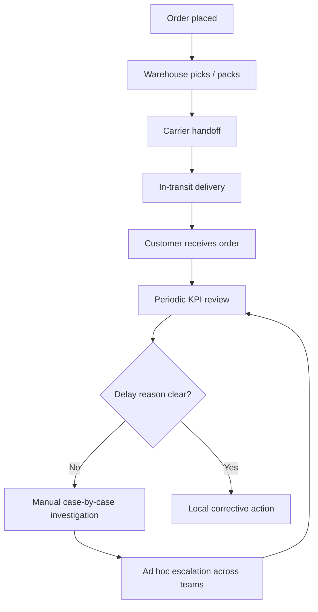
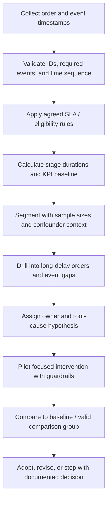

# Process Improvement Case — Order Fulfillment

> Process flows below are hypotheses to investigate in a real operation. The current portfolio data is generated, and no operational intervention has been tested.

## Problem hypothesis

An overall late-delivery rate alone may not explain where delays accumulate. A shared stage-based view can help operations teams move from aggregate reporting to evidence-led investigation, provided the source events and SLA definition are valid.

## As-is (hypothesised)

Potential friction to verify: inconsistent event timestamps, unclear SLA eligibility, delayed visibility of scan gaps, handoffs between teams, and segment percentages reported without sample size or context.

## To-be (proposed)

## Improvement opportunities

| Opportunity | Hypothesis to test | Guardrail |
|---|---|---|
| Metric dictionary and eligibility rules | Reduce debate and rework caused by inconsistent SLA calculations | Operations and CX approve definitions |
| Event sequence validation | Reduce misleading stage-duration metrics | Keep invalid records visible with reason |
| Stage duration and late-tail view | Focus investigation on the stage with the greatest elapsed time | Report median / P90 and volume, not average alone |
| Long-delay case drill-down | Speed up cause investigation | Include route, service, date, event history and case context |
| Controlled operational pilot | Estimate whether a change improves timeliness | Use predefined comparator, duration, and guardrail measures |

## Prioritisation approach

1. **Data contract first:** agree event definitions, late / on-time eligibility, timezone, cancellations and reschedules.
2. **Find the delay pattern:** inspect stage distributions, late severity, event gaps, and sample sizes.
3. **Validate root cause:** review individual cases with operational owners and compare like-for-like shipments.
4. **Pilot a narrow action:** choose a controllable process step and establish baseline and guardrails.
5. **Evaluate before scaling:** measure delivery performance and unintended consequences.

## Suggested pilot measures

- Primary: late-delivery rate or share meeting the agreed SLA.
- Diagnostic: P50/P90 end-to-end and stage duration, scan gaps, and late-delay severity.
- Guardrails: order damage/return rate, customer contacts, cost per shipment, cancellation rate, and total order volume.
- Evaluation: predefine period, unit of analysis, eligible orders, comparison group, and handling of demand/seasonality changes.

## Impact boundary

In the current generated dataset, transit is the largest average duration (31.81 hours of 41.02 hours end to end). This is a direction for checking the synthetic scenario, not evidence that a real transit team caused late orders. No saved time, reduced late rate, or monetary benefit is claimed.
